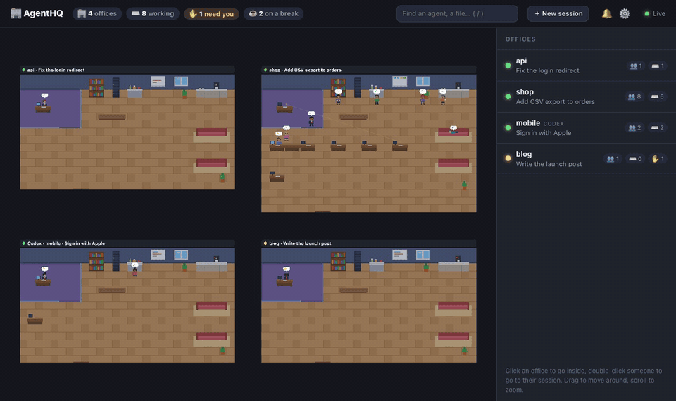
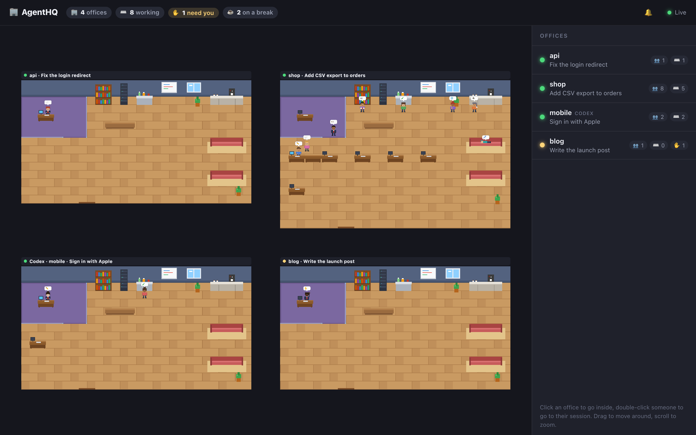
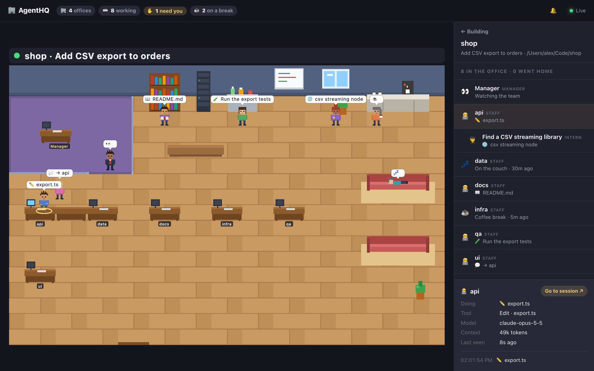
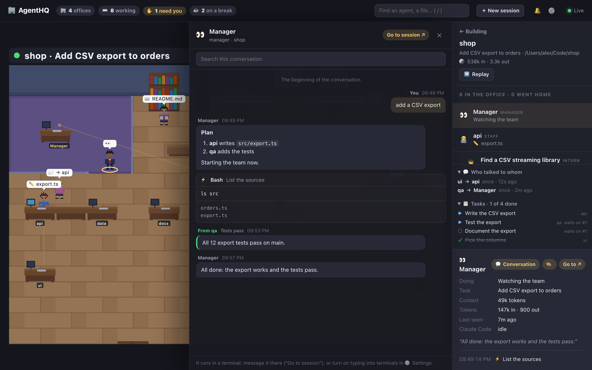

<div align="center">

# 🏢 AgentHQ

**A pixel-art office for your Claude Code and Codex sessions.**

[Website](https://charonova.github.io/agenthq/) · [How it works](#how-it-works) · [Develop](#develop)



</div>

---

Every live session is an office. Its main agent is the manager, every teammate gets a desk, and the helpers they start sit beside them as interns. Working agents type at their desks, read at the bookshelf, run tests at the lab and walk over to talk to each other; idle ones get coffee, then nap on the couch.

> 0.4, and moving fast. Works on macOS, Linux and Windows.

## Run it

You need [Node.js](https://nodejs.org) 20 or later. One command:

```bash
npx @charonova/agenthq          # opens the office at http://localhost:4747
npx @charonova/agenthq --list   # or print it in the terminal
```

Or install it: `npm install -g @charonova/agenthq`, then `agenthq`.

<table>
  <tr>
    <td width="50%"></td>
    <td width="50%"></td>
  </tr>
  <tr>
    <td align="center"><sub><b>The building</b> · every live session, on one map</sub></td>
    <td align="center"><sub><b>An office</b> · click anyone for their task, tool, model and context</sub></td>
  </tr>
  <tr>
    <td colspan="2"></td>
  </tr>
  <tr>
    <td colspan="2" align="center"><sub><b>A conversation</b> · anyone's full chat, live, with every tool call and its output</sub></td>
  </tr>
</table>

The pictures come from made-up sessions (`pnpm media`); AgentHQ shows your own.

- **The building**: every live session as an office on one map. Drag to move around, scroll to zoom, click an office to go inside.
- **In an office**: the manager in a glass office, staff at desks in their team colour, interns beside whoever started them. Bubbles say what each one is doing; click anyone for their task, tool, model, context and last words.
- **Where they go**: writing code → their desk · reading → the bookshelf · commands → the server rack · tests → the lab · web → the window · plans → the whiteboard · messaging a teammate → that teammate's desk · waiting for you → a raised hand, with what for (a permission prompt, a question) · idle → coffee, then the couch · a command left running in the background → by the server rack. They walk around the furniture, sit down and get up, and the door opens as they come and go.
- **It tells you when someone needs you**: a desktop notification and a chime when an agent starts waiting for you (🔔 in the header opens their settings); click one to jump there. The tab title shows how many are waiting, and the **✋ need you** counter goes to each in turn. Optionally, also when a session finishes.
- **A timeline per agent**: its latest tool calls, with times, under its details.
- **🪙 Tokens** per agent and per office: what each read and wrote (Codex's own totals; for Claude Code, counted from each transcript's last megabyte when AgentHQ first sees it, then as it grows, so a long session shows "at least").
- **Who talks to whom**: lines between teammates who message each other, and a list under the office's people (who, to whom, how often, when).
- **The team's tasks on the whiteboard**: Claude Code's shared task list as cards (waiting, in progress, done), and listed with who took each and what it waits on.
- **💬 The whole conversation**: open anyone's conversation, manager, teammate or helper, Claude Code or Codex: your prompts, its replies, every tool call with its input and output, messages between teammates. It follows along live, loads older messages as you scroll up (even in multi-gigabyte sessions), and you can search it.
- **＋ Start sessions from AgentHQ**: pick a folder, write the first message, choose the model and how it may work (ask me, accept edits, plan only, auto). It runs your own Claude Code through the official Agent SDK, with your account, settings and `CLAUDE.md`, and shows up as an office like any other. Chat with it from its conversation: its replies stream in as they're written, and you can send messages, interrupt it, end it. Its permission prompts and questions come to you as cards. A session that ended (one from your terminal too) can be **resumed here** by sending it a message; one still open in a terminal is messaged there.
- **✋ Answer from AgentHQ** (Claude Code, opt-in): permission prompts and questions show up in the agent's conversation. Allow once, pick one of Claude Code's own "always allow" choices, deny with a note on what to do instead, or choose the answers to its questions (or type your own). The terminal still shows the prompt and can answer it too; whichever answers first wins. Turn it on in ⚙️ Settings: it adds one `PermissionRequest` hook to `~/.claude/settings.json` (a copy of the file is saved first, your other hooks stay), and it does nothing while AgentHQ is closed. Turning it off removes it.
- **⌨️ Type into terminal sessions** (macOS, opt-in): turn it on in ⚙️ Settings, and a session running in Terminal or iTerm2 can be messaged from its conversation: your message is typed into its own tab (found by its terminal device), then Enter, as one line. macOS asks once to let AgentHQ control the app. When it can't (another app, or permission denied), your message is copied to paste there.
- **Go straight to a session**: double-click anyone (or **Go to ↗** in their details) and its window comes forward: the exact tab in Terminal or iTerm2, the project's window in VS Code, Cursor or Windsurf, or the app it runs in (macOS). Codex sessions too: AgentHQ finds the `codex` working in the thread's folder. On Linux and Windows, a session in VS Code, Cursor, Windsurf or VSCodium brings that folder's window forward; GNOME Terminal, Windows Terminal and other terminals can't be told to show one tab, so there (and whenever it can't) the command that resumes the session is copied for you.
- **Codex too**: each Codex thread is an office, with its sub-agents (like the guardian) as staff, named as in Codex's app.
- **🔌 Plugins** for more agent CLIs: a source plugin finds another agent's sessions and AgentHQ shows them as offices (opt-in with `--plugins`; see [docs/plugins.md](docs/plugins.md) and its example).
- **⏪ Replay**: an office's last two hours as a time-lapse: play it (1, 5 or 20 minutes a second) or scrub to any moment, and watch everyone go where they went.
- **🔍 Find anyone**: by name, project, task, or a file or command they touched, or list everyone waiting, working or resting (`/` jumps to it).
- **⌨️ Keyboard**: Tab and Enter go through the offices, the people in one and their conversation; Esc steps back out one thing at a time.
- **⚙️ Settings**, kept in your browser: day and night (follow the clock, always day, always night), animation speed, reduced motion (or follow your computer's), sounds and alerts, which offices show (hide one, ended sessions, or Codex's), and the switches above.
- **🎨 Choose anyone's look**: man or woman, skin, hair colour and style, from their details. Teammates keep the look you chose in every session; a manager keeps it per project.

## How it works

AgentHQ only **reads** what Claude Code writes in `~/.claude`, and nothing leaves your computer (the page is served on 127.0.0.1 only). Two exceptions, both your choice: sessions you start or resume from the page run your own `claude` (found on your PATH, including npm's `claude.cmd` on Windows, or set `AGENTHQ_CLAUDE_PATH`) and stop when AgentHQ closes; and answering from AgentHQ, when you turn it on: then it adds its hook to `~/.claude/settings.json`, and keeps its own files in `~/.agenthq` (its settings, the hook, the running server's address with a secret made fresh each start, and a log of what you answered, names and choices only).

| Office               | From                                                                                                                              |
| -------------------- | --------------------------------------------------------------------------------------------------------------------------------- |
| Offices              | Sessions in `~/.claude/projects/*/*.jsonl` active in the last 30 minutes                                                          |
| Manager              | The session's own transcript                                                                                                      |
| Staff                | Teammates: `<session>/subagents/agent-*.jsonl` whose `.meta.json` says `spawnDepth: 0` (name, colour, model)                      |
| Interns              | Helpers they started: `spawnDepth` 1+, with `parentAgentId`                                                                       |
| What each one does   | The last lines of its transcript: the tool it called, and how long ago                                                            |
| Where a session runs | `~/.claude/sessions/<pid>.json` (which process runs which session), then the app above that process                               |
| Codex                | `~/.codex/sessions/YYYY/MM/DD/rollout-*.jsonl` (a sub-agent's thread names its parent), names from `~/.codex/session_index.jsonl` |

Only the end of each transcript is read, so multi-gigabyte sessions stay fast; a conversation is read a page (192 KB) at a time, as you scroll. Settings: `AGENTHQ_JUMP=copy` makes "go to session" only copy the resume command (and typing into terminals only copy your message); `AGENTHQ_CLAUDE_HOME` reads another folder; `AGENTHQ_IGNORE=frag1,frag2` leaves out sessions whose folder contains those (claude-mem's background sessions are left out by default).

## Develop

A pnpm workspace:

| Package         | What                                                                                                   |
| --------------- | ------------------------------------------------------------------------------------------------------ |
| `packages/core` | The reader: live sessions → offices (Node, no dependencies); each agent CLI is a source (`sources.ts`) |
| `packages/cli`  | `@charonova/agenthq`: the command, the local server (Server-Sent Events), and the built web app        |
| `apps/web`      | The office: Vite + React + PixiJS (pixi-viewport for the camera), Zustand for state                    |
| `e2e`           | Playwright tests on a made-up `~/.claude`                                                              |

```bash
pnpm install
pnpm dev          # server + Vite with hot reload: http://localhost:5173
pnpm check        # lint, format, types, unit tests
pnpm build        # web app, then the CLI with it inside
pnpm e2e          # end-to-end tests (after a build), with screenshots in test-results/
pnpm start        # build, then open the office
pnpm media        # the README's screenshots and GIF, from made-up sessions
pnpm bench        # what drawing costs with 180 made-up agents (after a build)
```

CI runs the checks on Linux, macOS and Windows, and the end-to-end tests on Linux.

## License

MIT
